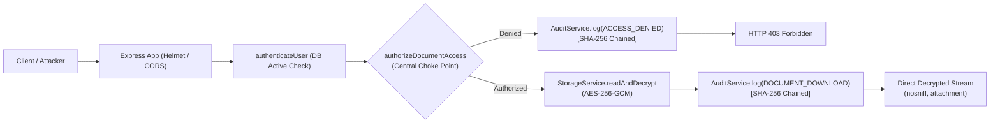

# TrustVault — Secure Document Sharing with a Real Audit Trail

> **"A document platform that leaks is not a partially working document platform."**  
> TrustVault is a zero-trust confidential document platform engineered where the wrong person can never read a file, taking access away works immediately, and every access or denied attempt is proven through a cryptographically chained audit trail.

---

## Benchmark Evaluation Credentials

The system includes pre-seeded accounts for each role with pre-configured confidential documents:

| Role | Email | Password | Access Rights & Purpose |
| :--- | :--- | :--- | :--- |
| **System Administrator** | `admin@trustvault.local` | `Password123!` | Manages users, inspects audit logs, runs cryptographic verification. Cannot read document contents without grant. |
| **Document Owner** | `owner@trustvault.local` | `Password123!` | Uploads confidential documents (Payroll, Legal), manages access grants, revokes access instantly, uses AI advisor. |
| **Authorized Viewer** | `viewer@trustvault.local` | `Password123!` | Named viewer granted read access to specific files. |
| **Unauthorized User** | `attacker@trustvault.local` | `Password123!` | Represents an unprivileged internal user or attacker attempting IDOR / privilege escalation. |

---

## Key Hand-In Artifacts

- 📋 [**THREATS.md**](./THREATS.md) — Comprehensive STRIDE threat model (12+ attack vectors), mitigation details, and test cross-references.
- 🤖 [**PROMPTS.md**](./PROMPTS.md) — Dated AI interaction journal documenting 5 instances of supervising AI, identifying flawed code (e.g. presigned URLs, unhashed audit logs, admin bypasses), and deploying defense-in-depth solutions.
- 📡 [**API.md**](./API.md) — Full endpoint reference specifying caller roles, authorization rules, and audit events.
- 📝 [**WRITEUP.md**](./WRITEUP.md) — Short write-up covering what we built, what we deliberately did not build, our permission model, and known trade-offs.
- 🎥 [**DEMO_SCRIPT.md**](./DEMO_SCRIPT.md) — 5-minute video presentation guide and live interview defense walkthrough.

---

## The Three Non-Negotiable Standards

1. **The Server Decides, Every Time**:
   All document content access and downloads funnel through a central choke point: `authorizeDocumentAccess(req, docId, action)`.
2. **You Can Prove Who Reached It (Cryptographic Hash-Chained Audit Trail)**:
   Every upload, download, permission change, and denied attempt is hashed using SHA-256 and chained to the previous record's hash (`current_hash = SHA256(prev_hash + entry)`). Any alteration of database rows immediately breaks the chain.
3. **Taking Access Away Works Immediately (0-Millisecond Latency)**:
   We strictly rejected presigned URLs and cached permission tokens. Every file download performs an indexed real-time database grant check. Revoking access halts subsequent requests instantly.

---

## Clean Clone Quickstart (Under 2 Minutes)

### Prerequisites
- Node.js v20+ (Node v22 LTS tested)
- npm v10+

### 1. Clone & Setup Backend
```bash
cd backend
npm install
npx prisma db push
npx tsx prisma/seed.ts
```

### 2. Run Automated Security Test Suite
```bash
npm test
```
*Executes all 15 security, authorization, negative IDOR, instant revocation, tamper detection, and file upload tests.*

### 3. Start Backend Server
```bash
npm run dev
```
*Backend runs on `http://localhost:5000`.*

### 4. Setup & Start Frontend
In a new terminal:
```bash
cd frontend
npm install
npm run dev
```
*Open `http://localhost:5173` in your browser.*

---

## Architectural Highlights



---

when any one asks:
 *"Where is the authorisation decision made when someone downloads a file, and what would happen if that line were removed?"*

1. **File**: `backend/src/middleware/authorizeDocument.ts`
2. **Line**: Line 92: `if (!grant) throw new AuthorizationError('Access Denied', 403);`
3. **Defense**: If removed, automated security tests (`npm test` -> `tests/authorization.test.ts` Suite 1 & 2) fail immediately, alerting the team to the authorization regression.
